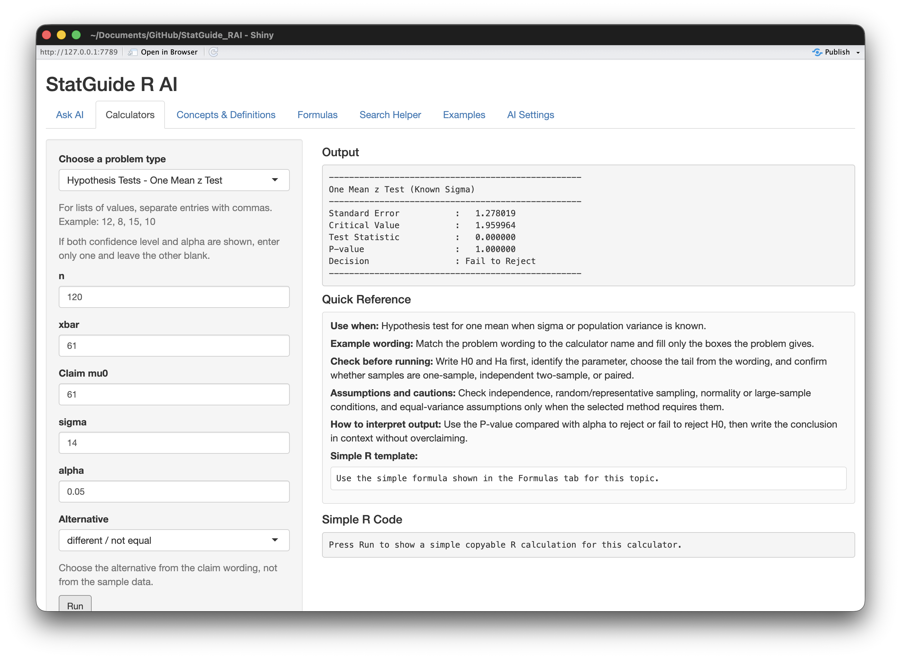
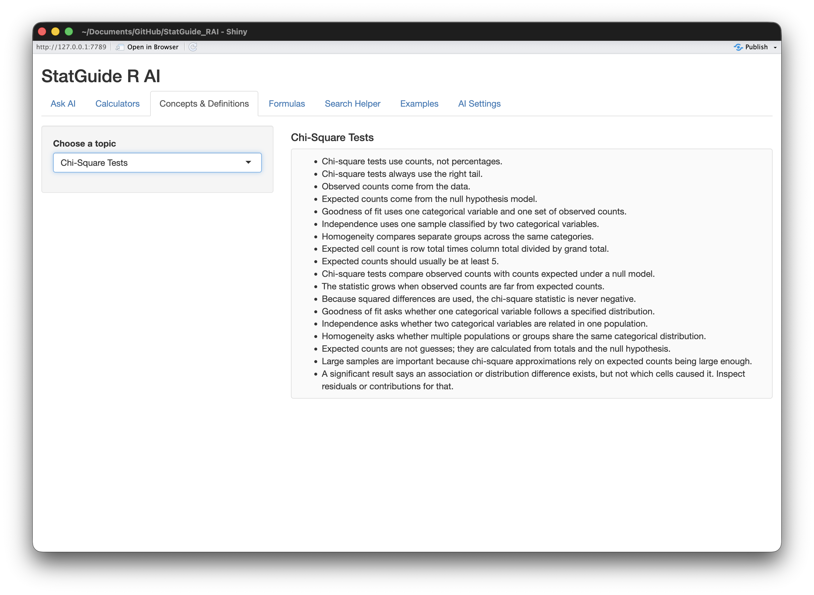
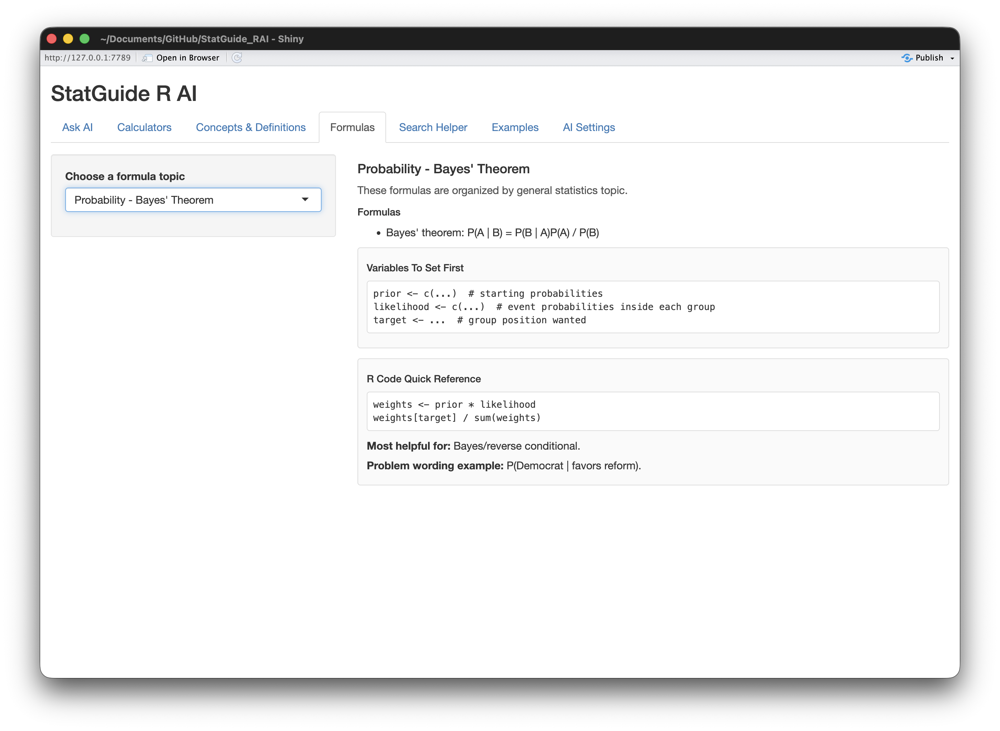
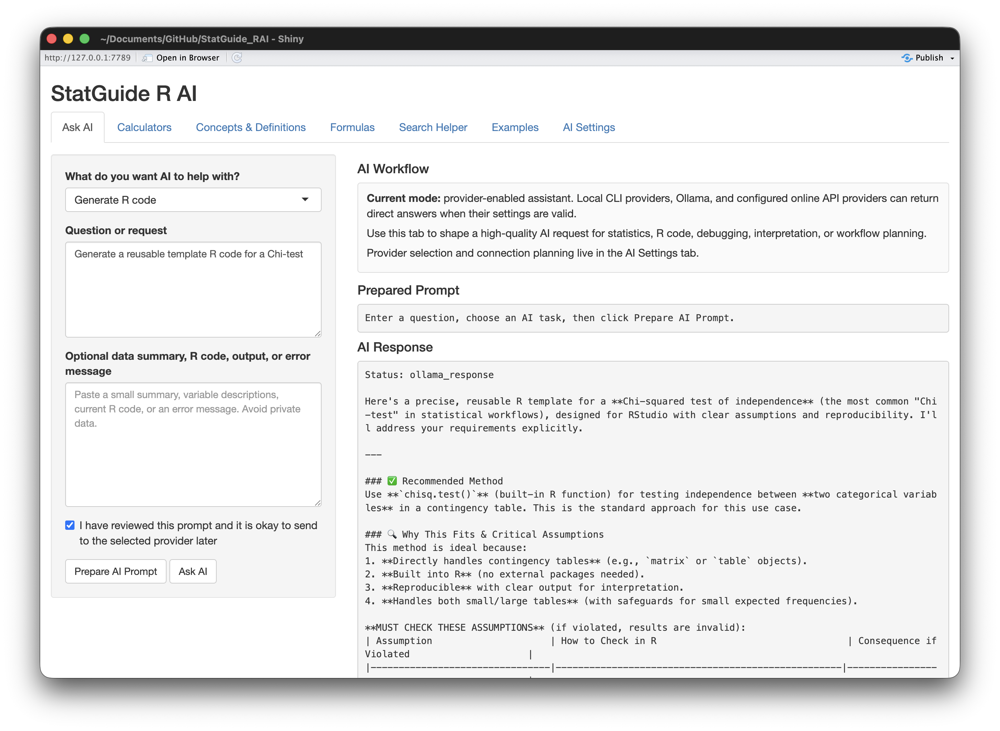

# StatGuide R AI

StatGuide R AI is a Shiny app for working through statistics problems, checking formulas, using calculators and getting help with R code. I built it to be the kind of app I would want open while studying, doing homework, reviewing stats concepts or trying to remember how to write the right R command.

This project started from a program I made for my STAT411 class. At first it was mostly a calculator app but I kept adding more and more to it as I went through the class. Eventually it turned into a place for my statistics notes, R code notes, formulas, examples and step-by-step problem help.

After the class was over, I decided to clean it up and redesign it into something more general that could be useful outside of one class. I also started adding AI features, like using Codex CLI from the RStudio workflow, because AI tools are becoming a normal part of programming and data work. The AI part is optional though. The main purpose of the app is still to be a statistics calculator, guide, and R helper.

## What It Does

- Gives calculator-style help for common statistics problems.
- Helps with descriptive statistics, probability, confidence intervals, hypothesis tests, regression, and related topics.
- Provides concepts, definitions, formulas, examples, and search guidance.
- Helps generate or review R code for common statistics and data analysis tasks.
- Includes an optional Ask AI workflow for statistics questions, R code help, debugging, and interpretation.
- Supports local/desktop AI workflows such as Codex CLI and Ollama, with planned support for other providers.

## Examples

Here are a few screenshots showing what the app currently looks like.

### Calculator Example

The calculators are meant to help work through common stats problems with inputs, output, quick reference notes, and R code guidance.



### Concepts And Definitions

The guide sections give quick explanations and reminders for statistics topics, so the app can work as a study/reference tool too.



### Formula Reference

The formulas tab keeps important formulas and simple R code templates in one place.



### Optional AI Helper

The Ask AI tab can help with R code, debugging, statistics explanations, and interpretation when a supported provider is connected. This screenshot shows an Ollama response.



## AI Provider Status

The AI tools are optional. You can use the app without connecting any AI provider.

So far, I have personally tested:

- Codex CLI
- Ollama

These provider options are included in the app, but I have not personally tested them yet because I do not currently have access to them:

- Claude Code CLI
- OpenAI-compatible APIs
- Anthropic/Claude API
- Other external API providers

Those API/provider options should be treated as works in progress until they can be tested with real accounts and keys.

## Project Status

This project is still in active development. The app runs locally, the calculator and reference sections are being improved, and the AI provider options are being built out as I test what I have access to.

## Requirements

- R
- Shiny
- Optional: Ollama, Codex CLI, Claude Code CLI, or API credentials configured through environment variables.

Install Shiny if needed:

```r
install.packages("shiny")
```

## Run The App

Open `app.R` in RStudio/Posit and click **Run App**, or run:

```r
shiny::runApp()
```

## AI Provider Setup

See [AI-PROVIDER-SETUP.md](AI-PROVIDER-SETUP.md) for local CLI, Ollama, OpenAI-compatible API, and Anthropic/Claude setup notes.

Do not commit real API keys or tokens. Use environment variables such as `OPENAI_API_KEY` or `ANTHROPIC_API_KEY`.

## Tests

From the project folder, run:

```bash
Rscript tests/baseline_checks.R
Rscript tests/calculator_reliability_checks.R
Rscript tests/ai_provider_checks.R
```

## Privacy And Safety

- Do not paste private datasets, secrets, tokens, or regulated information into AI prompts.
- Prefer summaries, small examples, and variable descriptions when asking AI for help.
- Review generated R code before running it, especially code that reads files, writes files, installs packages, or calls external services.
- Verify statistical assumptions and calculations before using AI-generated results in school, work, or personal projects.
