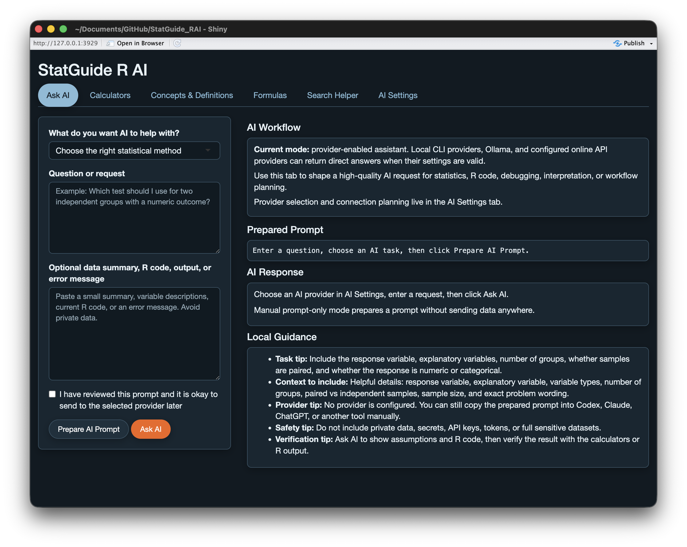
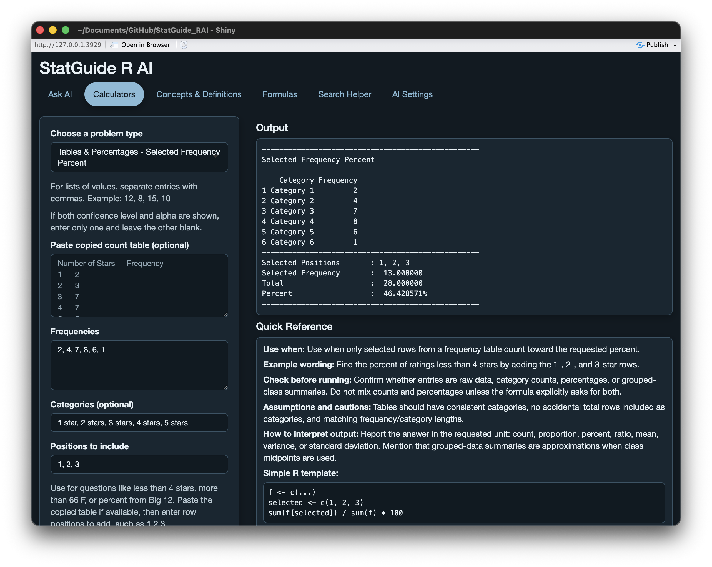
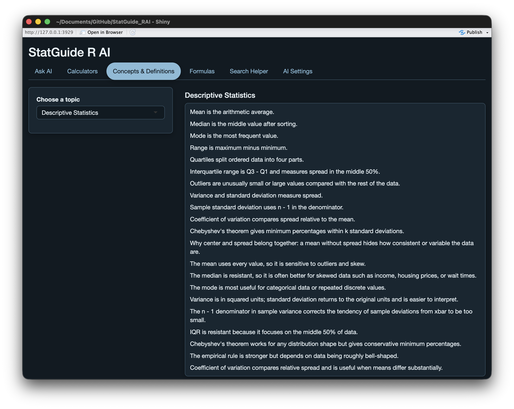
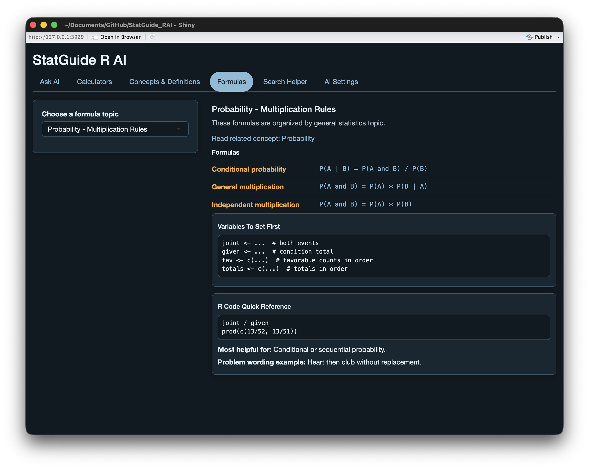
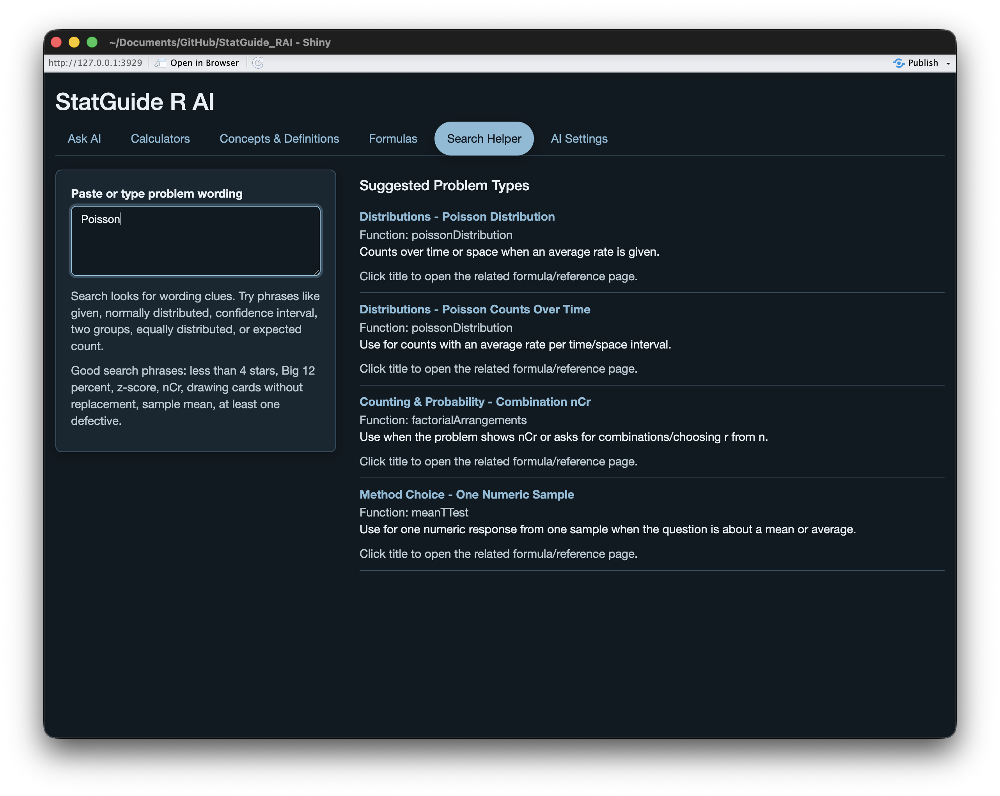
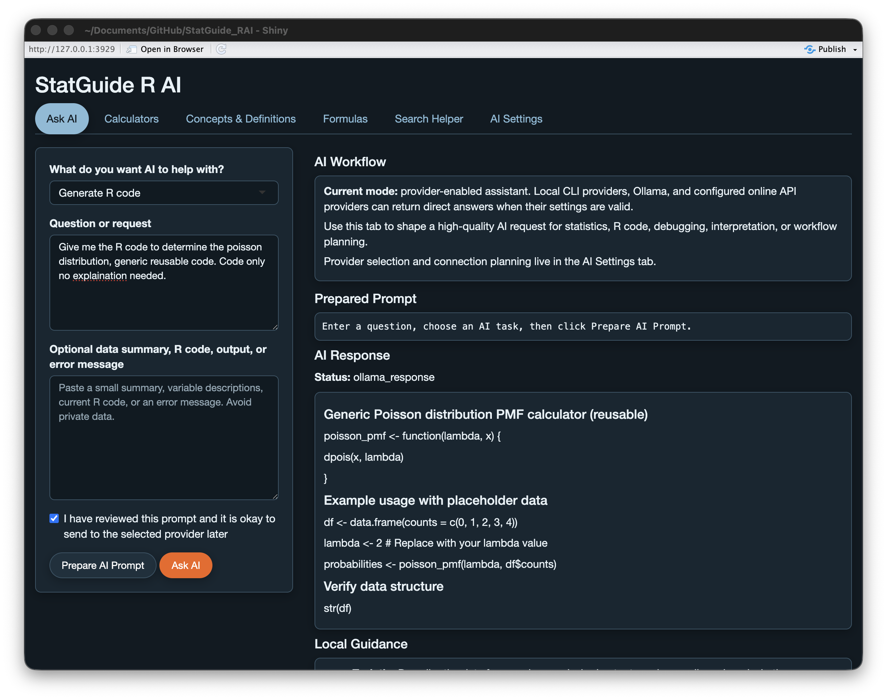
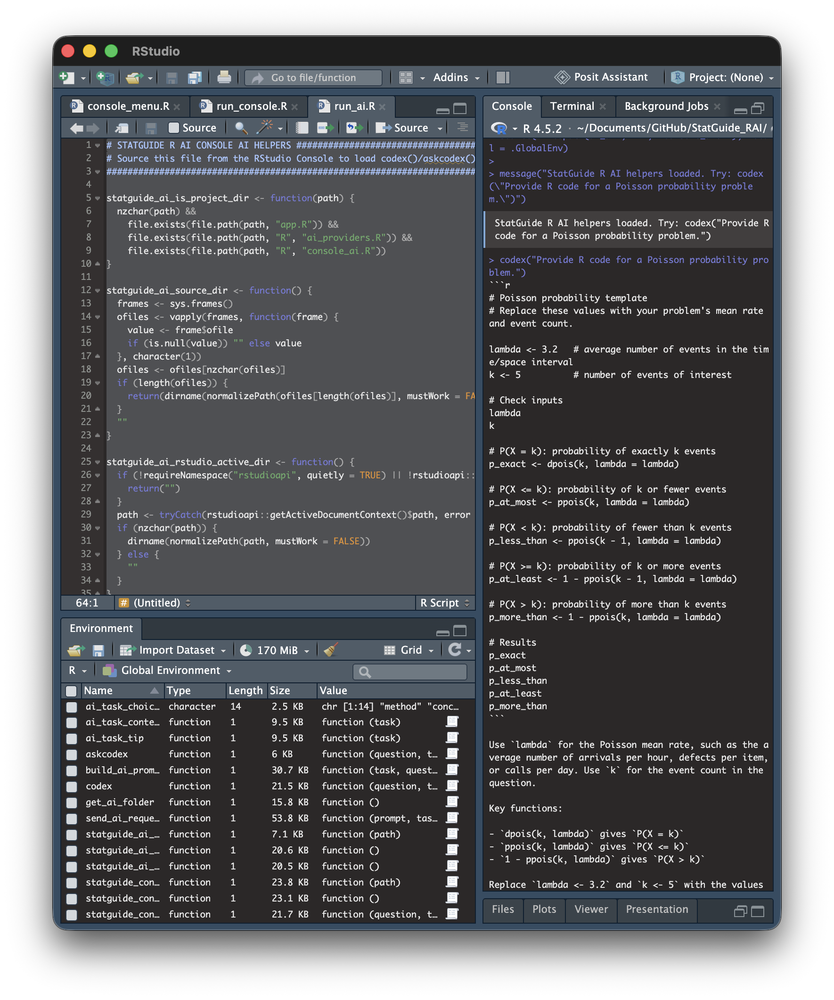
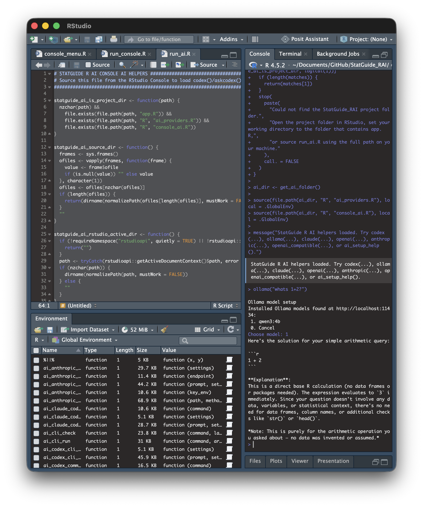
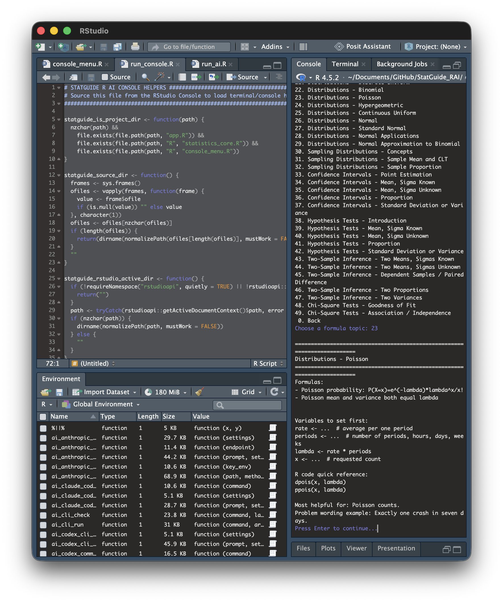

# StatGuide R AI

StatGuide R AI is a Shiny app for working through statistics problems, checking formulas, using calculators and getting help with R code. I built it to be the kind of app I would want open while studying, doing homework, reviewing stats concepts or trying to remember how to write the right R command.

This project started from a program I made for my STAT411 class. At first it was a large file full of all my R code and notes. I learned about Shiny and realized I could make a GUI app out of my notes. It started as a calculator app but I kept adding more and more to it as I went through the class. Eventually it turned into something I figured could be useful for others.

After the class was over, I decided to clean it up and redesign it into something more general that could be useful outside of one class. I also started adding AI features, like using Codex CLI from the RStudio workflow, because AI tools are becoming a normal part of programming and data work. The AI part is optional though. The main purpose of the app is still to be a statistics calculator, guide, and R helper.

* This redesign was mainly done using OpenAI's Codex. I wanted this version of the project to be an example of my ability to build something useful with AI through proper prompting. My GitHub is mainly here to showcase my software development skills but with the job market moving more toward AI assisted development, I also wanted to show that I know how to use AI as a tool to build real software, not just generate code.


## What It Does

- Gives calculator-style help for common statistics problems.
- Helps with descriptive statistics, probability, confidence intervals, hypothesis tests, regression, and related topics.
- Provides concepts, definitions, formulas, calculator quick references, and search guidance.
- Helps generate or review R code for common statistics and data analysis tasks.
- Includes an optional Ask AI workflow for statistics questions, R code help, debugging, and interpretation.
- Supports tested local/desktop AI workflows such as Codex CLI and Ollama, with additional provider options included as works in progress.

## Examples

Here are a few screenshots showing what the app currently looks like.

### Ask AI

The Ask AI tab helps prepare better prompts for statistics, R code, debugging, interpretation, and workflow planning. It can still be used in manual prompt-only mode if no AI provider is connected.



### Calculator Example

The calculators are meant to help work through common stats problems with inputs, output, quick reference notes, and R code guidance.



### Concepts And Definitions

The guide sections give quick explanations and reminders for statistics topics, so the app can work as a study/reference tool too.



### Formula Reference

The formulas tab keeps important formulas and simple R code templates in one place.



### Search Helper

The search helper lets you type problem wording and jump toward the calculator or reference topic that is most likely to fit.



### Optional AI Helper

The Ask AI tab can help with R code, debugging, statistics explanations, and interpretation when a supported provider is connected. This screenshot shows an Ollama response.



### RStudio Console AI Helpers

The AI-only console entry point loads direct helper functions such as `codex()`, `ollama()`, `openai()`, and `anthropic()` without opening the full menu. This is useful when I just want to ask for R code directly from the RStudio Console.



The Ollama helper can also guide setup by listing installed local models and asking which one to use.



### RStudio Console Menu

The console menu version gives numbered access to calculators, concepts, formulas, search helper, and Ask AI inside the RStudio Console.



## AI Provider Status

The AI tools are optional. You can use the app without connecting any AI provider.

So far, I have personally tested:

- Codex CLI
- Ollama

These provider options are included in the app, but I have not personally tested them yet because I do not currently have access to them:

- Claude Code CLI
- OpenAI-compatible APIs
- Anthropic/Claude API
- Other external API providers

Those API/provider options should be treated as works in progress.

## Project Status

This project is still in active development. The app runs locally, the calculators, search helper, formulas, and concepts/reference sections are working, and the AI provider options are being built out as I test what I have access to.

## Requirements

- R
- Shiny
- For AI providers: the `curl` and `jsonlite` packages.
- Optional: `mirai`, so the app stays responsive while waiting for an AI answer.
- Optional: Ollama, Codex CLI, Claude Code CLI, a local OpenAI-compatible server (LM Studio, llama.cpp, vLLM), or API credentials configured through environment variables.

Install the packages if needed:

```r
install.packages(c("shiny", "curl", "jsonlite", "mirai"))
```

## Quick Start (No Coding Needed)

1. Install R from [cran.r-project.org](https://cran.r-project.org) if you do not have it yet.
2. Download this project: on GitHub click **Code**, then **Download ZIP**, and unzip it.
3. Open the project folder and double-click the launcher:
   - Mac: **Start StatGuide.command**
   - Windows: **Start StatGuide.bat**
4. The app opens in your web browser. The first start takes a minute while it installs the R packages it needs.
5. Keep the small terminal window open while you use the app. Close it to stop the app.

If your Mac says the file "cannot be opened because it is from an unidentified developer", right-click the file, choose **Open**, then click **Open** again. You only need to do this once.

To connect an AI model, click **New to AI? Set up a model step by step** in the Ask AI tab. It walks you through each option in plain language and checks that it works.

### Running From A Terminal

R files run with R, not Python, and typing a file name alone does not run it. From the project folder:

```bash
Rscript app.R
```

`run_ai.R` and `run_console.R` are for an interactive R session, because they load helpers that you then type commands into. Start R by typing `R` in the terminal (or open RStudio), then:

```r
source("run_ai.R")       # AI helpers such as codex("...") and ollama("...")
source("run_console.R")  # numbered menu
```

Type `q()` to leave R.

## Run The App

There are three local entry points:

- `app.R` opens the Shiny GUI app.
- `run_console.R` opens the numbered RStudio Console menu with calculators, references, search, and Ask AI.
- `run_ai.R` loads only the AI console helpers, including local CLI, Ollama, and API helper functions.

For the GUI app, open `app.R` in RStudio/Posit and click **Run App**, or run this in the R console:

```r
shiny::runApp()
```

From a terminal, run this from any folder (it opens the app in your browser; press Ctrl+C to stop):

```bash
Rscript path/to/StatGuide_RAI/app.R
```

## RStudio Console Versions

To open the full console menu open the file run_console.R and source the file or run:

```r
source("run_console.R")
```

This starts the numbered menu automatically in an interactive RStudio Console session.

To load only the AI helpers open the file run_ai.R and source the file or run:

```r
source("run_ai.R")
```

Then call a local provider directly:

```r
codex("Provide the R code for a Poisson probability problem with lambda 2 and x 3.")
ollama("Explain Poisson lambda in R.")
```

If a console helper needs setup, it will prompt you through the missing pieces. For example, `ollama()` can list installed local Ollama models when Ollama is running, and API helpers ask for model names, endpoints, environment variable names, and explicit send confirmation. The console helpers work on their own; the Shiny app does not need to be running.

Available console AI helpers include:

- `codex()` / `askcodex()` for Codex CLI.
- `ollama()` / `askollama()` for a local Ollama model. `Ollama()` also works as a capitalized alias.
- `claude()` / `askclaude()` for Claude Code CLI.
- `openai()` for OpenAI-compatible API calls.
- `anthropic()` for Anthropic/Claude API calls.
- `openai_compatible()` for a custom OpenAI-compatible endpoint.
- `askai()` for choosing any supported provider manually.
- `ai_setup_help()` for setup reminders.

For API providers, do not paste API keys into the app or into project files. Set keys outside the project, such as in your user `.Renviron` file, then pass only the environment variable name:

```r
openai("Explain a one-sample t interval.", model = "gpt-model-name", allow_external = TRUE)

openai_compatible(
  "Write R code for a mean confidence interval.",
  model = "model-name",
  endpoint = "https://your-provider.example/v1",
  key_env = "OPENAI_API_KEY",
  allow_external = TRUE
)
```

The console menu also has an Ask AI option with provider choices. Online providers require a typed confirmation before sending.

## AI Provider Setup

Local OpenAI-compatible servers work through the "Generic OpenAI-compatible endpoint" provider. Use a `localhost` or `127.0.0.1` endpoint such as `http://localhost:1234/v1`; no API key or send approval is needed for those.

See [AI-PROVIDER-SETUP.md](AI-PROVIDER-SETUP.md) for local CLI, Ollama, OpenAI-compatible API, and Anthropic/Claude setup notes.

Do not commit real API keys or tokens. Use environment variables such as `OPENAI_API_KEY` or `ANTHROPIC_API_KEY`.

## Tests

From the project folder, run:

```bash
Rscript tests/baseline_checks.R
Rscript tests/calculator_reliability_checks.R
Rscript tests/ai_provider_checks.R
Rscript tests/console_checks.R
```

## Privacy And Safety

- Do not paste private datasets, secrets, tokens, or regulated information into AI prompts.
- Prefer summaries, small examples, and variable descriptions when asking AI for help.
- Review generated R code before running it, especially code that reads files, writes files, installs packages, or calls external services.
- Verify statistical assumptions and calculations before using AI-generated results in school, work, or personal projects.
